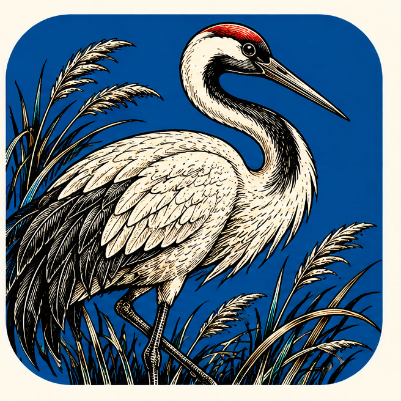
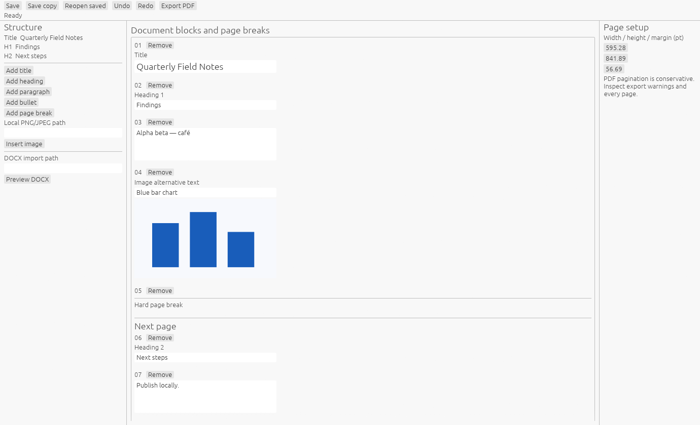

<p align="center">
  
</p>

<h1 align="center">WordStrike</h1>

<p align="center">
  <a href="https://prowebdevsolutions.com"><picture>
    <source media="(prefers-color-scheme: dark)" srcset="assets/branding/PWDS-logo-orange.svg">
    
  </picture></a>
</p>

<p align="center"><strong>Give every page a purpose.</strong></p>

WordStrike is a Windows-first workspace for building documents from text blocks and images. Edit a `.wstrike` project, adjust pages, undo changes, and export PDF from the optional native editor.



The native editor opened a self-authored field-notes project for this capture. The image shows the document structure, editable blocks, page setup, and toolbar; it does not establish an interactive or accessibility review. See [screenshot provenance](docs/SCREENSHOT_PROVENANCE.md).

<p align="center"><a href="#highlights">Highlights</a> · <a href="#build-and-test">Build and test</a> · <a href="assets/branding">Original artwork</a></p>

## Highlights

- Compose structured text with embedded PNG or JPEG images.
- Keep an editable `.wstrike` document.
- Preview or import a bounded DOCX subset and export PDF.

## Current status

Native editor source prototype. The standalone package passed 21 locked tests at the earlier checkpoint. The capture-only source change built a Windows native executable offline; no tests were rerun for that change and no installer or release is supplied. DOCX support is bounded and native interaction, accessibility, and broad format fidelity remain unverified.

## Files and export

The editable `.wstrike` archive is the document source. DOCX import and preview cover a bounded subset; tracked changes and broken image references are refused, and inline styling can flatten. PDF export comes from the native editor. These paths do not establish broad Word round-trip fidelity.

## Build and test

Install a Rust toolchain that supports edition 2024, then from the repository root run:

```powershell
cargo test --locked --manifest-path apps/wordstrike/Cargo.toml --all-features
cargo build --locked --manifest-path apps/wordstrike/Cargo.toml --bin wordstrike-native --features native-ui
```

The app has its own `Cargo.lock` and `[workspace]`. Its path dependencies resolve to `vendor/designcraft-page`, whose eight selected Rust crates, needed fonts, hyphenation data, ICC profile, upstream licenses, and notices are included. Synthetic DOCX and image fixtures live in `fixtures/wordstrike` at their tested relative paths. Cargo fetches the remaining dependencies from crates.io.

## Limits and source terms

Pagination uses conservative block-height estimates. DOCX import is bounded and refuses tracked changes and broken image references; imported inline bold and italic styling can be flattened. The editable `.wstrike` format is the source of truth, rather than a claim of Word document round-trip fidelity. Native pointer, keyboard, screen reader, high contrast, scaling, font fallback, and other-platform acceptance are pending.

The app's first-party license has not been selected; no first-party license grant is made here. The bundled upstream DesignCraft subset retains its original MIT/Apache license texts and third-party font/asset notices. See [SOURCE_SCOPE.md](SOURCE_SCOPE.md) for provenance and the tested boundary.

## PWDS brand artwork

The company mark in this masthead is the existing [official PWDS logo](https://github.com/Gerbzz/PWDS-Website/blob/main/public/prowebdevsolutions-logo.png), with the [official orange display asset](https://prowebdevsolutions.com/images/prowebdevsolutions-logo-orange.svg) for dark backgrounds. The app logo above it remains the original Strike suite artwork.
