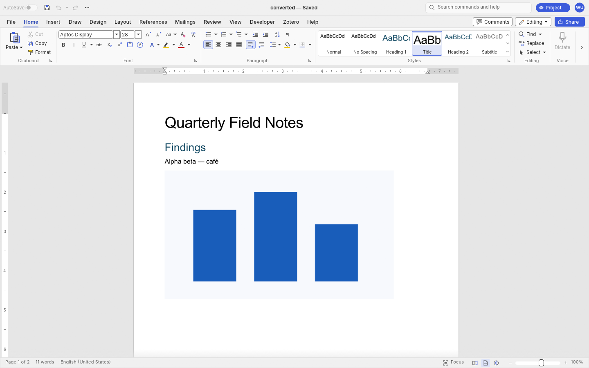

<p align="center">
  
</p>

<h1 align="center">WordStrike</h1>

<p align="center">
  <a href="https://prowebdevsolutions.com"><picture>
    <source media="(prefers-color-scheme: dark)" srcset="assets/branding/PWDS-logo-orange.svg">
    
  </picture></a>
</p>

<p align="center"><strong>Give every page a purpose.</strong></p>

WordStrike is a Windows-first document editor for structured text, images, and page layout. This repository preserves the original editable `.wstrike` prototype and adds a native foundation for rich text, DOCX, PDF, proofing, and a ribbon-style desktop interface, with an explicit import path between them.



This is the **current native foundation**, captured after importing a self-authored `.wstrike` fixture, saving it as DOCX, and reopening the DOCX. See [native runtime evidence](docs/NATIVE_RUNTIME_ACCEPTANCE.md). The [older lightweight editor screenshot](assets/screenshots/wordstrike-editor.png) remains available with its [own provenance](docs/SCREENSHOT_PROVENANCE.md).

<p align="center"><a href="#foundation">Foundation</a> · <a href="#build-and-test">Build and test</a> · <a href="assets/branding">Original artwork</a></p>

## Foundation

- `native/wordstrike` contains the complete source graph of the WordCraft document, layout, DOCX, PDF, proofing, command, and egui desktop crates, pinned to upstream commit [`04f6f53`](https://github.com/storytold/wordcraft/commit/04f6f53b8a4d8140c7bb62f949b0a6099a473da1).
- The desktop target is named `wordstrike`, uses the WordStrike geometric page mark, and exposes the donor's ribbon, page canvas, formatting, review, and document commands. Internal Rust crate names remain unchanged for dependency compatibility. Historical crane artwork remains preserved in the repository.
- File > Open offers an import picker for the original `.wstrike` archive. `file.importLegacy` converts it into a new unsaved native document, prompting before replacing unsaved work. It maps titles, level 1-2 headings, styled paragraph runs, page setup, page breaks, and bounded, fully decoded PNG/JPEG images with alt text. It refuses lists, invalid image references, unbound object markers, and unsupported heading levels rather than silently dropping them.
- `apps/wordstrike` remains the original lightweight editor. It keeps its own archive format and can still be built independently.

## Current status

**Native foundation at a source-stage checkpoint.** [Windows CI for draft source `03ea913`](https://github.com/Gerbzz/WordStrike/actions/runs/38668293554) built the desktop editor and passed the targeted legacy import, safe-save, import UI, and Save Changes guard tests. A CI-built executable from that run was launched on Windows with an isolated synthetic document: import, DOCX Save As, source preservation, DOCX reopen, and an authentic rendered window capture passed. See [the exact runtime receipt and limits](docs/NATIVE_RUNTIME_ACCEPTANCE.md). No installer or binary release is supplied. Interactive editing, accessibility, and broad file fidelity still need verification.

## Files and export

The lightweight editor uses `.wstrike` as its editable source. Its DOCX import covers a bounded subset; tracked changes and broken image references are refused, and inline styling can flatten. The newer native engine has its own document model and DOCX path. The explicit import command leaves the original `.wstrike` file untouched and requires **Save As** to create a native document. Layout may change during conversion.

## Build and test

Install Rust 1.95 or newer (required by the pinned `craft-libs`). The native workspace needs crates.io packages and the pinned `storytold/craft-libs` Git dependency. From the repository root:

```powershell
cargo run --manifest-path native/wordstrike/Cargo.toml -p wordcraft --bin wordstrike
cargo test --offline --locked -j 1 --manifest-path native/wordstrike/Cargo.toml -p wordcraft-engine --test legacy_import
cargo test --offline --locked -j 1 --manifest-path native/wordstrike/Cargo.toml -p wordcraft-engine --test safe_save
cargo test --locked --manifest-path native/wordstrike/Cargo.toml -p wordcraft-ui-egui --lib legacy_import
cargo test --locked --manifest-path native/wordstrike/Cargo.toml -p wordcraft-ui-egui --lib save_changes_waits_for_the_save_as_answer
```

The targeted engine commands passed locally and in CI. The UI commands passed in CI. The desktop editor compiled in CI and completed the bounded Windows runtime check described above. The lockfile includes the local legacy dependency and resolves offline on the authorized machine.

To build and test the older lightweight editor independently:

```powershell
cargo test --locked --manifest-path apps/wordstrike/Cargo.toml --all-features
cargo build --locked --manifest-path apps/wordstrike/Cargo.toml --bin wordstrike-native --features native-ui
```

The older editor has its own `Cargo.lock` and `[workspace]`. Its path dependencies resolve to `vendor/designcraft-page`, whose eight selected Rust crates, fonts, hyphenation data, ICC profile, licenses, and notices are included. Synthetic DOCX and image fixtures live in `fixtures/wordstrike`.

## Limits and source terms

The older editor's pagination uses conservative block-height estimates, and its DOCX import is bounded. The newer native foundation has a much broader editing source graph and one successful synthetic import/save/reopen runtime check. Native pointer, keyboard, screen reader, high contrast, scaling, font fallback, wider document compatibility, and other-platform behavior remain to be checked. Neither editor is claimed to match Microsoft Word.

The original first-party WordStrike code has no selected license; this repository makes no new grant for it. The native WordCraft-derived workspace retains upstream MIT/Apache license texts, copyright notices, and asset attribution under `native/wordstrike`; the older DesignCraft subset retains its licenses and notices under `vendor/designcraft-page`. See [SOURCE_SCOPE.md](SOURCE_SCOPE.md) and [native adaptation notes](native/wordstrike/ADAPTATION.md).

## PWDS brand artwork

The company mark in this masthead is the existing [official PWDS logo](https://github.com/Gerbzz/PWDS-Website/blob/main/public/prowebdevsolutions-logo.png), with the [official orange display asset](https://prowebdevsolutions.com/images/prowebdevsolutions-logo-orange.svg) for dark backgrounds. The app logo above it is the [original WordStrike geometric page mark](assets/branding/GEOMETRIC-IDENTITY.md); historical Strike artwork and its provenance remain at their original paths.
